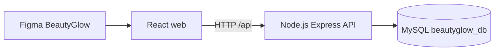

# BeautyGlow: Mô tả thiết kế CSDL và liên kết Figma → Backend

## I. Sơ đồ tổng quan

**Figma** chỉ là bản thiết kế và Prototype. **React** thực hiện các thao tác thật trên trình duyệt. **Express API** kiểm tra token, xác thực quyền sở hữu dữ liệu, tính tiền và thực hiện câu SQL. **MySQL** lưu dữ liệu bền vững.

## II. 12 bảng chính

| Bảng | Vai trò | Liên kết FK |
|---|---|---|
| users | Khách hàng và quản trị viên; lưu hash mật khẩu | Bảng gốc |
| addresses | Các địa chỉ giao hàng của khách | `user_id → users.id` |
| categories | Danh mục mỹ phẩm | Bảng gốc |
| brands | Thương hiệu mỹ phẩm | Bảng gốc |
| products | Sản phẩm, giá bán, tồn kho | `category_id → categories.id`, `brand_id → brands.id` |
| cart_items | Mỗi sản phẩm trong giỏ của 1 tài khoản | `user_id → users.id`, `product_id → products.id` |
| favorites | Danh sách sản phẩm yêu thích | `user_id → users.id`, `product_id → products.id` |
| coupons | Mã giảm giá BG50 | Bảng độc lập; API kiểm tra mã |
| orders | Đơn hàng, thông tin người nhận và tổng tiền tại thời điểm đặt | `user_id → users.id` |
| order_items | Các dòng sản phẩm thuộc một đơn, lưu giá snapshot | `order_id → orders.id`, `product_id → products.id` |
| payments | Phương thức COD/MoMo và trạng thái thanh toán | `order_id → orders.id` (unique) |
| reviews | Sao đánh giá và nhận xét của người dùng | `user_id → users.id`, `product_id → products.id` |

Các liên kết quan trọng: **users 1:N orders**; **orders 1:N order_items**; **orders 1:1 payments**; **categories 1:N products**; **brands 1:N products**; **users N:M products** thông qua bảng `favorites` hoặc `cart_items`.

### Vì sao phải có `order_items` thay vì chỉ lưu `product_id` ở `orders`?

Một đơn có nhiều sản phẩm. `order_items` lưu lại **tên và đơn giá khi khách đã đặt**, nên sau này cập nhật giá trong `products` vẫn không làm thay đổi thông tin lịch sử đơn.

### Vì sao mật khẩu không phải chuỗi thuần?

Backend sử dụng `bcryptjs.hash(..., 12)` khi đăng ký, và so khớp hash khi đăng nhập. SQL chỉ lưu `password_hash`.

## III. Màn Figma và bảng được dùng

| Chức năng thiết kế | API | CSDL liên quan |
|---|---|---|
| Đăng ký tài khoản | `POST /api/auth/register` | `users` |
| Đăng nhập | `POST /api/auth/login` | `users` |
| Trang chủ, danh mục | `GET /api/categories`, `GET /api/products` | `products`, `categories`, `brands` |
| Tìm kiếm, lọc giá 200k–500k | `GET /api/products?min_price=200000&max_price=500000` | `products` |
| Chi tiết sản phẩm | `GET /api/products/:id` | `products` |
| Thêm vào giỏ | `POST /api/cart` | `cart_items` |
| Xem, tăng, giảm, xóa giỏ | `GET /api/cart`, `PATCH /api/cart/:id`, `DELETE /api/cart/:id` | `cart_items`, `products` |
| Chọn/thêm địa chỉ | `GET /api/addresses`, `POST /api/addresses` | `addresses` |
| Xác nhận thanh toán | `POST /api/orders` | `orders`, `order_items`, `payments`, `cart_items`, `products`, `coupons` |
| Đơn hàng của tôi | `GET /api/orders`, `GET /api/orders/:id` | `orders`, `order_items`, `payments` |
| Yêu thích | `GET /api/favorites`, `POST/DELETE /api/favorites/:id` | `favorites`, `products` |

## IV. Ba đơn minh họa tương ứng Figma

| Mã đơn | Dòng hàng | Tạm tính | Giảm | Ship | Tổng |
|---|---|---:|---:|---:|---:|
| BG123456 | Laneige 520k + CeraVe 400k + BeautyGlow 240k | 1.160.000 | 50.000 | 20.000 | 1.130.000 |
| BG123457 | Cùng ba sản phẩm nhưng COD | 1.160.000 | 50.000 | 20.000 | 1.130.000 |
| BG123458 | Serum Vitamin C 299k | 299.000 | 0 | 20.000 | 319.000 |

Đơn mẫu tạo bởi script `npm run seed:demo` để dễ kiểm tra, không được trừ tồn kho như đơn người dùng đặt thực tế. Đơn đặt qua giao diện **có trừ tồn kho và xóa giỏ** theo transaction.

## V. Giới hạn của phiên bản học tập

- Code demo chỉ tái hiện **những luồng chính**, không dựng đầy đủ hơn 100 màn của file Figma.
- OTP, xác thực qua Google, thanh toán MoMo thực và gửi email chưa được tích hợp.
- Frontend lưu JWT vào `localStorage` để demo nhanh; sản phẩm thật nên dùng cơ chế phiên an toàn hơn như cookie `HttpOnly`, `Secure`, `SameSite` và triển khai HTTPS.
- Bộ ảnh trong `web/public/assets` là minh họa SVG; cần thay bằng tài sản có quyền sử dụng khi làm sản phẩm chính thức.
